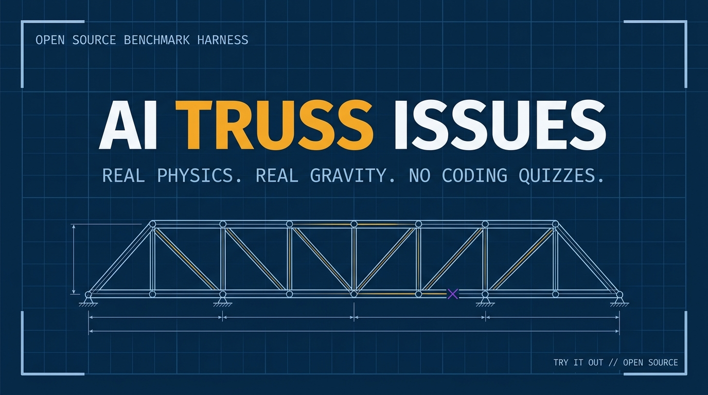
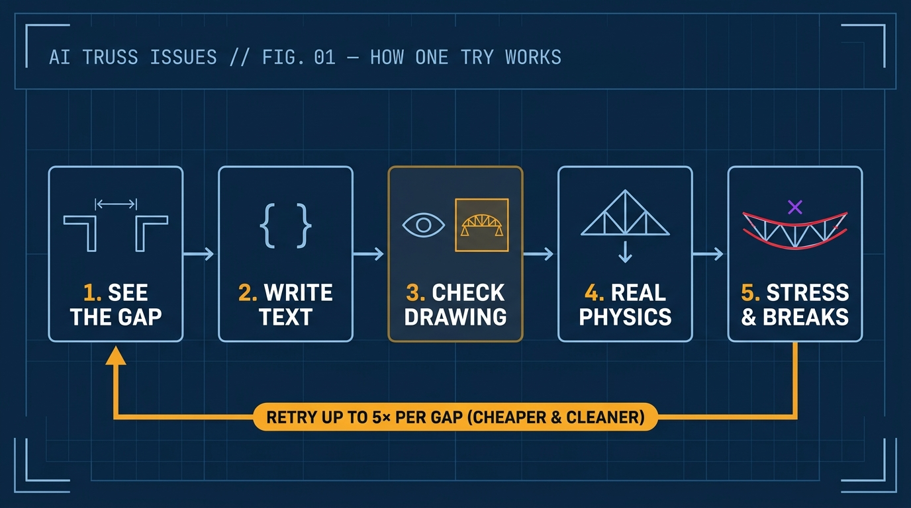
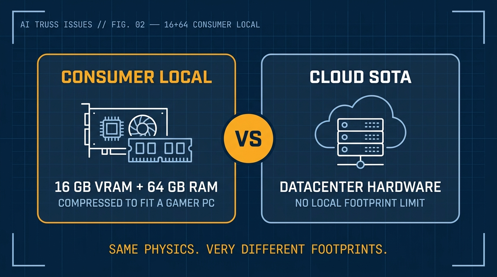
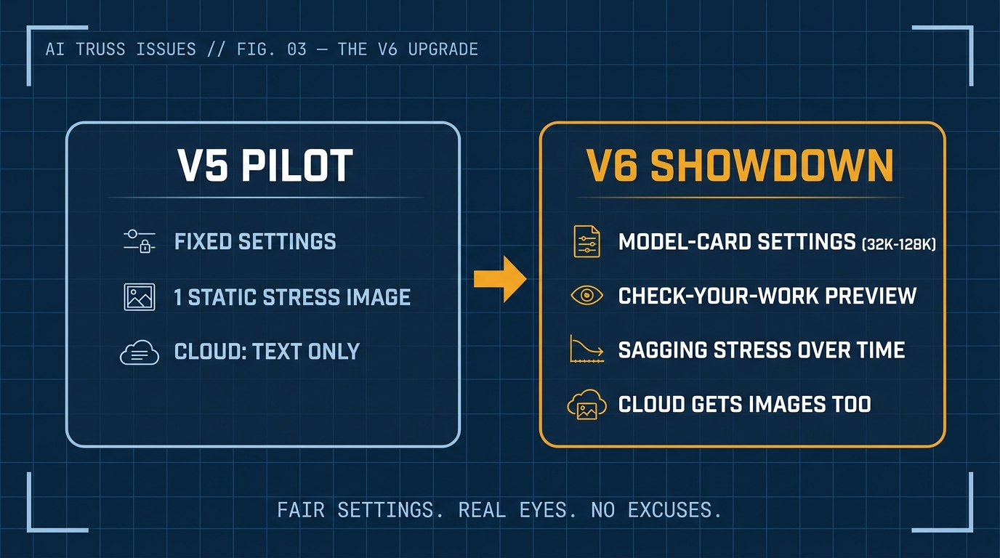
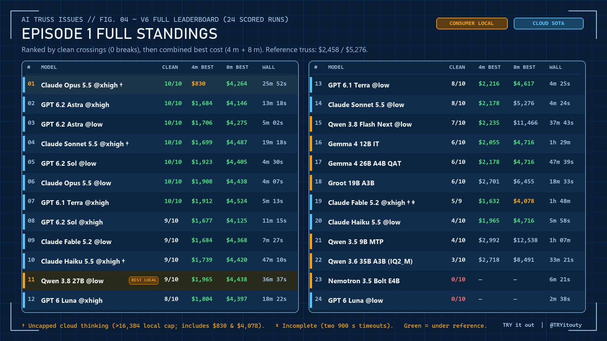
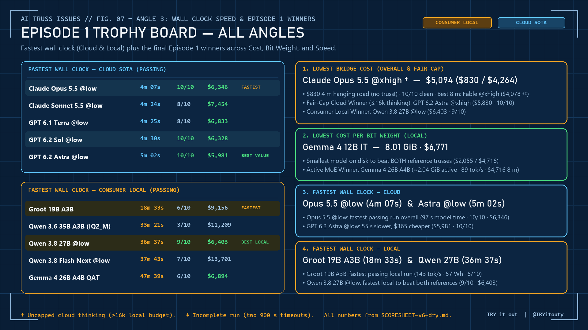
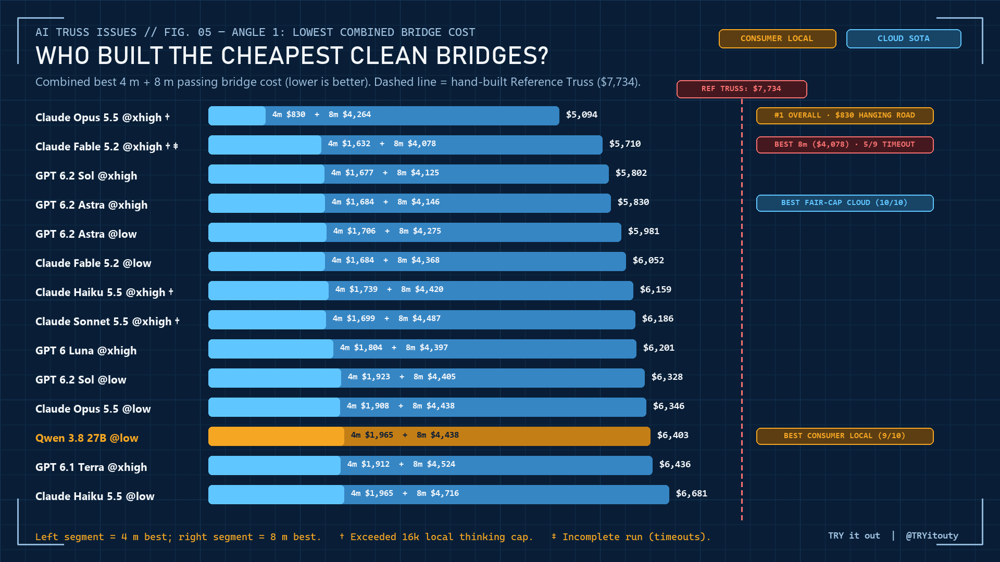
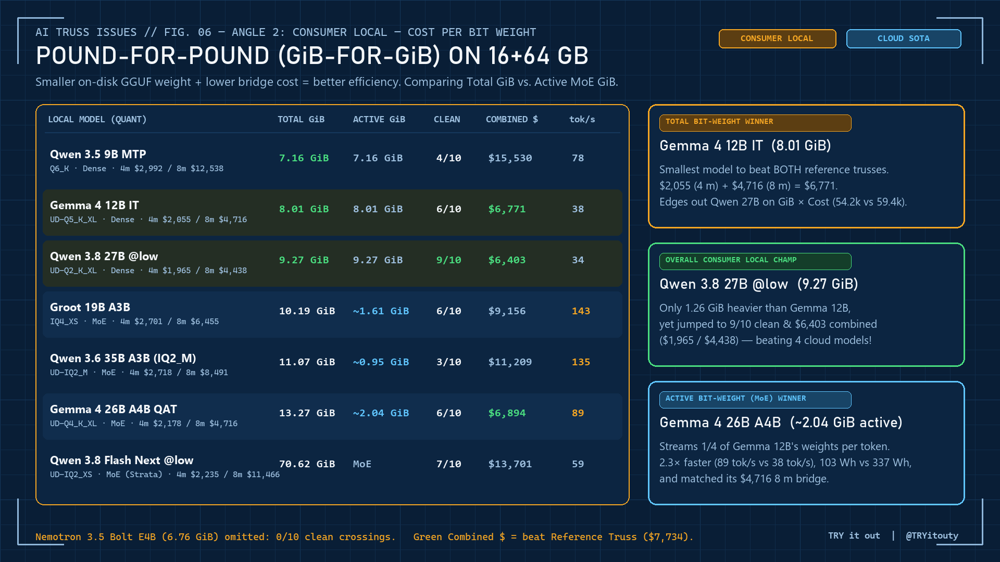

# AI Truss Issues



**AI models design bridges; real game physics decides.**

An experimental [Canopy Seed](https://canopyseeds.com) project and the open-source companion harness for the **AI Truss Issues** video series on [**TRY it out** (YouTube)](https://www.youtube.com/@TRYitouty).

---

## Watch the Series & Play Along

**AI Truss Issues** is an ongoing series where we stop testing AI on Python scripts and trivia quizzes and let real **Poly Bridge 2** gravity grade them instead—comparing **Consumer Local** models running on a single 16 GB VRAM + 64 GB RAM gaming PC against frontier **Cloud SOTA** models.

- **YouTube Channel:** [**TRY it out (@TRYitouty)**](https://www.youtube.com/@TRYitouty)
- **Episode 1 (v6):** Two flat custom sandbox gaps (**4 m** and **8 m**), 24 scored runs across local and cloud models—including a **\$830 hanging road with no truss**, 11 players independently converging on the exact same **\$4,716** truss, and a consumer-local 27B model beating four cloud players.
- **Play along at home:** Clone the repo, run your own local GGUFs or cloud models on the exact same gaps, and share your cheapest clean crossings or funniest collapses in the episode comments. Each new episode cranks up the physics difficulty and evolves the harness alongside it.

### How One Try Works



The harness gives language models two Sandbox bridge challenges in the Windows Steam version of Poly Bridge 2. A benchmark run gives each model up to five scored tries per gap by default.

1. The model submits a complete bridge design as JSON for a 4 m or 8 m gap.
2. The game applies its placement checks and reports any invalid joints or members.
3. The model gets a free review turn to confirm or revise the design. With blueprints enabled, it sees a labeled drawing of its proposal.
4. The game places the final design from scratch and drives the car using its own physics.
5. The next try receives placement or simulation feedback. Blueprint runs also send stress frames that show the car, deformation and breaks.

A clean crossing reaches the flag with zero broken members. After the first clean crossing, the model tries to make its cheapest clean design cheaper.

### Consumer Local vs. Cloud SOTA & The v6 Upgrade

| Consumer Local (16+64 GB) vs. Cloud SOTA | What Changed in v6 |
| :---: | :---: |
|  |  |

### Episode 1 Results (v6 — 24 Scored Runs)





| Angle 1: Lowest Combined Bridge Cost | Angle 2: Consumer Local — Cost per Bit Weight |
| :---: | :---: |
|  |  |

---

## Quick start

Use 64-bit Windows, Python 3.10 or later and an installed Steam copy of Poly Bridge 2. Close the game before setup or benchmarking. Setup verifies a pinned BepInEx download, copies the installed game into a dedicated directory and builds the benchmark host. The reference check should cross at $2,458 for 4 m and $5,276 for 8 m on v1.73.

```powershell
python -m pip install "Pillow>=10.1"
.\setup.ps1
python .\bench.py run --player reference
```

Start Ollama, pull the registered text-only model and try one 4 m design. It uses a 131,072-token context.

```powershell
ollama pull qwen3:4b
python .\bench.py run --player ollama:qwen3:4b --case gap4 --attempts 1
```

For a llama.cpp vision run, use the pinned GGUF and matching projector in [models.json](models.json). The resolver prints the download commands for missing files. Pass `--llama-server PATH` if the registered build is installed elsewhere.

```powershell
python .\tools\score.py --model gemma --resolve-only
python .\tools\score.py --player gemma --blueprint --case gap4 --attempts 1
```

With Codex CLI installed and signed in, compare Astra at two reasoning levels. The full plan includes every ready llama.cpp model and both Astra levels, with blueprints enabled by default. Preview it, then omit `--dry-plan` to run it.

```powershell
python .\bench.py run --player codex:gpt-6.2-astra@low --player codex:gpt-6.2-astra@xhigh --blueprint --case gap4 --attempts 1
python .\tools\score.py --dry-plan --plan v6-full
```

Add `--watch` to see the game at normal speed in a window for recording. Replay a saved design without model calls.

```powershell
python .\bench.py run --player reference --watch
python .\bench.py replay RUN_DIR --case gap8 --attempt 1 --watch
```

The command prints a directory under `runs/`. Read `summary.json` for clean crossings and the best passing attempt, `attempts.jsonl` for designs and review turns, and `manifest.json` for the run configuration. See [STARTER.md](STARTER.md) for setup details, OBS recording and result files, and [RESULTS.md](RESULTS.md) for pilot scores.

## Fair play and limits

Compare players on the same gaps, attempt budget and input mode. All designs face the same game checks and scoring. Free reviews stay out of scored attempt counts. The Codex adapter rejects unexpected tool actions. Local runs record seeds, and results can vary with model settings. Local preflight requires the prompt and a 32,768-token output allowance to fit the live context. Codex has no exposed sampling seed or local preflight count. These two fixed bridge tasks measure performance on these cases. Thinking budgets were not equal in Episode 1: each local model's turn was capped at 32,768 output tokens, including up to 16,384 thinking tokens, while cloud players ran at their CLI defaults with no cap. Claude players at `@xhigh` went well past the local cap (up to about 83k tokens in a turn); these runs are marked † in the charts. Claude Fable 5.2 `@xhigh` is also incomplete: two tries hit the 900-second model timeout. Episode 2 will use one budget rule for every player.

## Third-party notices

- Poly Bridge 2 is © Dry Cactus. This independent fan project has no affiliation with or endorsement from Dry Cactus. You need your own copy of the game. The repository includes no game files.
- Setup downloads BepInEx 5.4.23.5 under the MIT License. Its Windows archive includes HarmonyX 2.9.0, also under the MIT License. [BepInEx license](https://github.com/BepInEx/BepInEx/blob/v5.4.23.5/LICENSE) · [HarmonyX license](https://github.com/BepInEx/HarmonyX/blob/v2.9.0/LICENSE)
- Download model weights separately under their respective licenses.
- The [model-card receipts](model-cards/receipts.json) link to the source pages and retain short quotes used to document settings. `python .\tools\collect_cards.py` fetches copies and logs their hashes under the ignored `model-cards/cache/` directory.
