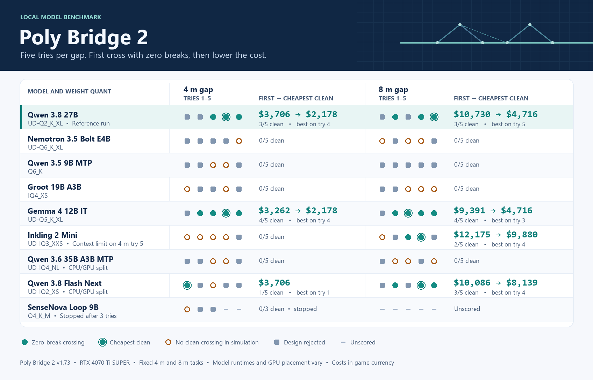

# V5 pilot results

The pilot used Poly Bridge 2 v1.73, physics version 1, and two fixed Sandbox gaps. A clean crossing reaches the flag with zero breaks. Prices are in game currency.

## Reference and GPT 6.2 Astra

Each player had one scored attempt per gap and the same text task. All four crossings were clean.

| Player | 4 m gap | 8 m gap |
| --- | --- | --- |
| Reference truss | $2,458 | $5,276 |
| GPT 6.2 Astra via Codex | $2,313 | $5,570 |

On the 8 m gap, peak stress was 44.41% for the reference and 34.90% for Astra.

## Local models with blueprints and five tries

The benchmark sent a blueprint on each try and carried forward the cheapest clean design for cost optimization. The table gives the clean crossing count and the cost of the first and cheapest clean crossings when available.

| Model | GGUF quant | 4 m gap | 8 m gap |
| --- | --- | --- | --- |
| Qwen 3.8 27B | UD-Q2_K_XL | 3/5, $3,706 (try 3) → $2,178 (try 4) | 3/5, $10,730 (try 2) → $4,716 (try 5) |
| Nemotron 3.5 Bolt E4B | UD-Q6_K_XL | 0/5 | 0/5 |
| Qwen 3.5 9B MTP | Q6_K | 0/5 | 0/5 |
| Groot 19B A3B | IQ4_XS | 0/5 | 0/5 |
| Gemma 4 12B IT | UD-Q5_K_XL | 4/5, $3,262 (try 2) → $2,178 (try 4) | 4/5, $9,391 (try 2) → $4,716 (try 3) |
| Inkling 2 Mini | UD-IQ3_XXS | 0/5 | 2/5, $12,175 (try 3) → $9,880 (try 4) |
| Qwen 3.6 35B A3B MTP | UD-IQ4_NL | 0/5 | 0/5 |
| Qwen 3.8 Flash Next | UD-IQ2_XS | 1/5, $3,706 (try 1) | 3/5, $10,086 (try 2) → $8,139 (try 4) |
| SenseNova Loop 9B | Q4_K_M | 0/3, stopped after try 3 | Unscored |

Gemma had eight clean crossings and tied Qwen 3.8 27B for the lowest cost on both gaps. At the shared $2,178 cost for the 4 m gap, peak stress was 24.62% for Gemma and 73.68% for the 27B model.

## Inkling 2 Mini with and without blueprints

The separate, paired trial used the same model quant, server and feedback in both conditions, with three tries per gap. The blueprint condition also showed a labeled PNG on each try. After simulation, the next image showed peak stress and break points.

| Input | 4 m gap | 8 m gap | Clean crossings |
| --- | --- | --- | --- |
| Text and feedback | 0/3 | 1/3, first pass on try 3 at $9,759 | 1/6 |
| Text, feedback and blueprint | 1/3, first pass on try 3 at $5,347 | 2/3, first pass on try 1 and best cost $8,491 on try 2 | 3/6 |

The cheapest blueprint crossings reached 13.36% peak stress on the 4 m gap and 30.26% on the 8 m gap. The text-only pass reached 35.53% on the 8 m gap. The trial covered two gaps.

Episode 1 (v6) results, with 24 scored runs across local and cloud players, are in the [README](README.md#episode-1-results-v6--24-scored-runs).
